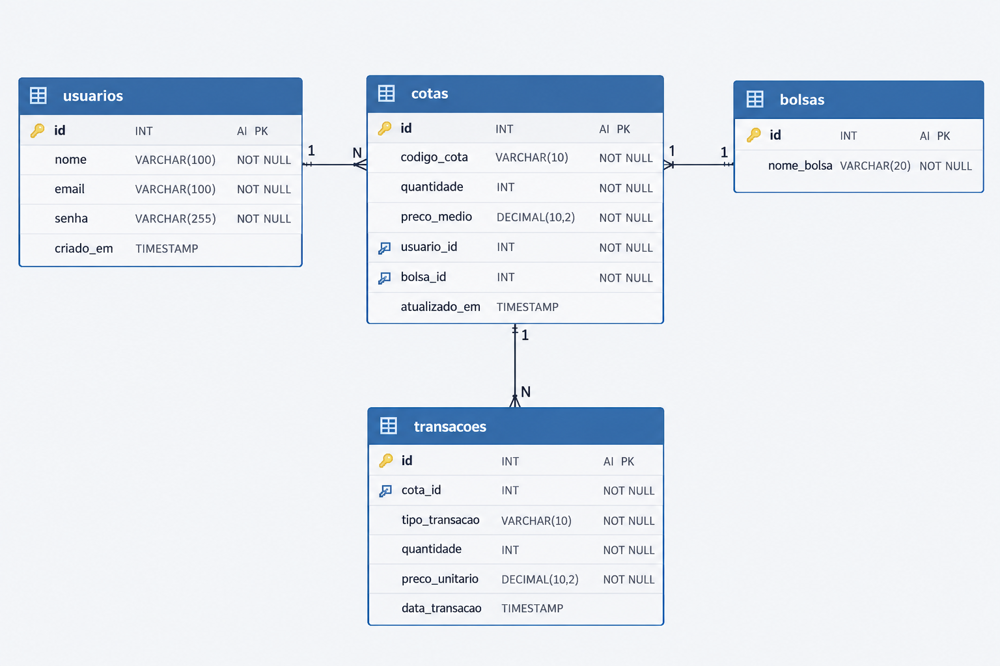
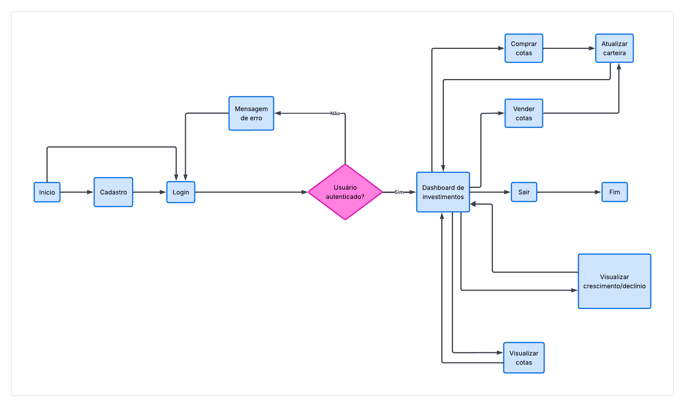

## PILAR I - Planejamento da aplicação:

- Nome: DAM ('Digital Asset Management')

- Descrição do problema: Necessidade de vizualizar em tempo real seus investimentos na bolsa de valores e poder gerenciar com facilidade, praticidade e segurança!!

- Descrição do funcionamento: O APP tem como objetivo pegar os dados da API em relação as aplicações na bolsa de valores do usúario e os valores atualizados das bolsas em tempo real.

- Funcionalidades previstas: Login, cadastro, compras e vendas de cotas, visualização do crescimento ou declínio das aplicações do usúario.

-  Modelo de dados da API:

### Um Usuário pode ter várias Cotas (1:N), mas uma Cota pertence a apenas um Usuário.

### Uma Bolsa pode conter várias Cotas (1:N), mas uma Cota pertence a apenas uma Bolsa.

- EndPoints da API: 

## Publica:
get /usuario/login
{
    email: "email@gmail.com",
    senha: "********"
}

resposta: Login efetuado/status:200

post /usuario/cadastro
{
    name:"nome"
    email:"email@gmail.com"
    senha:"********"
}
resposta: Cadastro efetuado com sucesso!!/status:201

get bolsa/visualizacao
resposta: Todas as bolsas na API./status:200
## Privada:

post bolsa/usuario/venda
{ 
    email:"email@gmail.com"
    bolsa:"bolsa"
    qntd:183
}
resposta: Bolsa {bolsa} na quantidade {qntd} vendida com sucesso!! /status:200

post bolsa/usuario/compra
{
    email:"email@gmail.com"
    bolsa:"bolsa"
    qntd:183
}
resposta: Bolsa {bolsa} na quantidade {qntd} comprada com sucesso!! /status:200

- Fluxo de navegação entre telas:

- 

## PILAR II - Interface e componentização:
